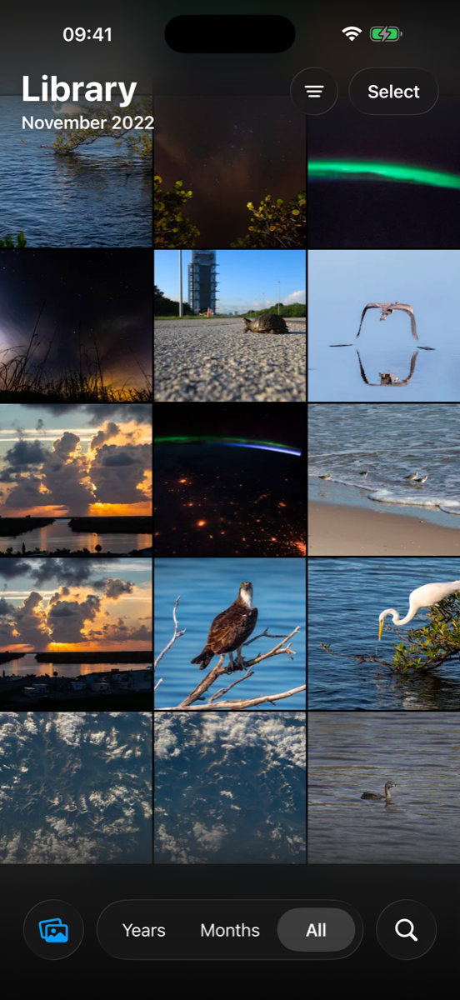
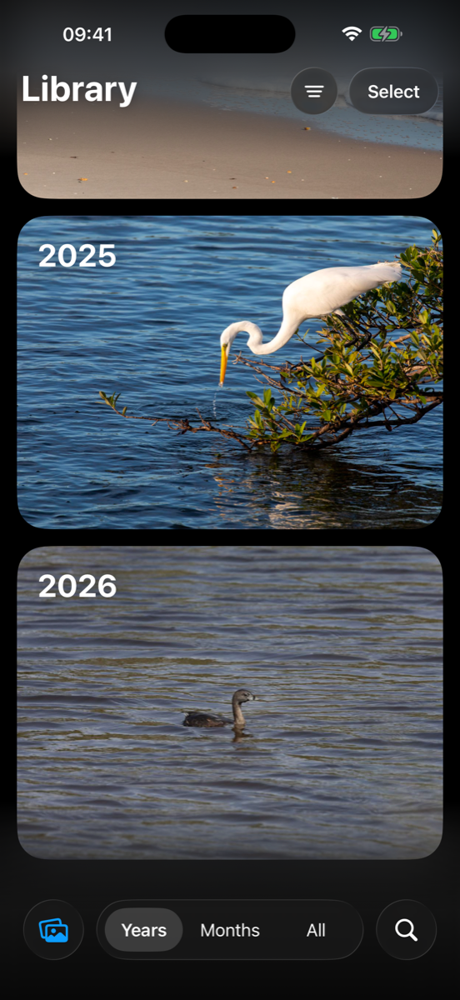
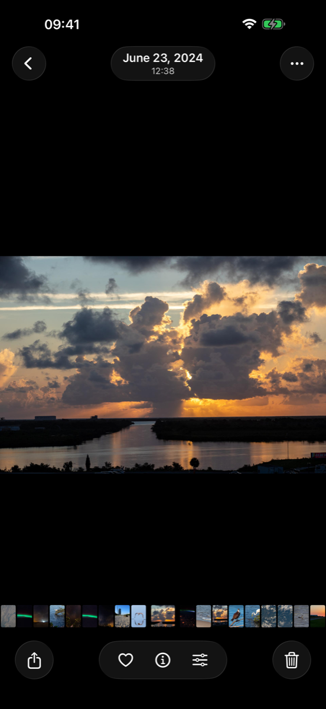
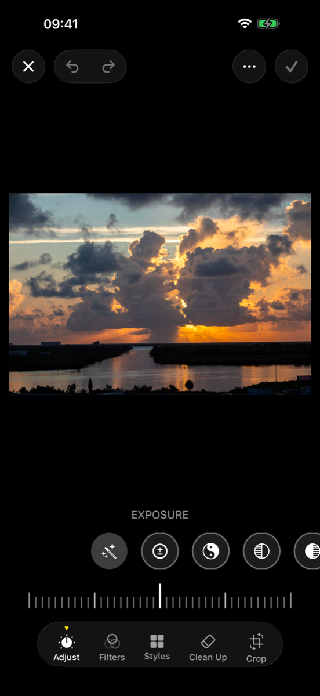
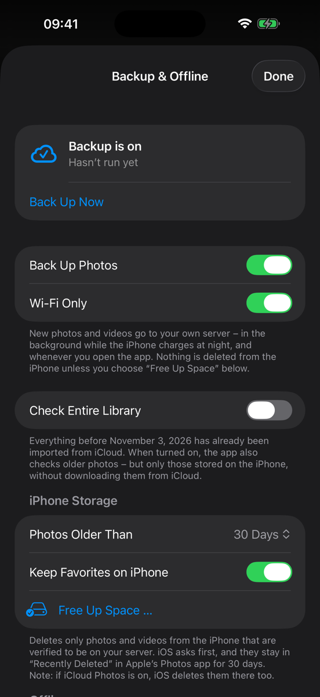

# HomeRoll

**A native iOS photos app for your own [Immich](https://immich.app) server – the look and feel of the iPhone Photos app, without iCloud.**

HomeRoll is an independent iPhone client for a self-hosted Immich server. It aims to feel like Apple's Photos app on iOS 26 (grid, zoom levels, viewer, editor, memories, search, people …) while all photos stay on hardware you own.

> **Status:** works and is used daily against Immich v3.3.5 with ~85,000 photos and videos. UI in **English and German** (follows the iPhone language; more translations welcome). Code comments are in German.
>
> Built with help from [Claude Code](https://claude.com/claude-code): I did the research (Apple's Photos frameworks analysed with [rea](https://github.com/morluto/rea)), the design decisions and daily testing on my own iPhone, a lot of the Swift was written together with it.
>
> **Personal project:** I use it every day and keep it working as long as I need it myself. No guarantees, no support promises. Bug reports and pull requests are welcome, but I answer when I have time.
>
> Not affiliated with Apple or with Immich/FUTO. "Immich" is a trademark of its owners.
>
> **On a Mac?** [HomeRoll Desktop](https://github.com/silentprovider423/HomeRoll-Desk) is the macOS sibling – edits made there look the same on the iPhone.

<p align="center">
  
  
  
  
  
</p>
<p align="center"><sub>Screenshots with public-domain sample photos (NASA/Kennedy Space Center, ISS crew).</sub></p>

## Features

**Library**
- Albums, Favorites, Trips and People with the same pinch-to-zoom grid and *Newest/Oldest first* sorting
- Timeline for 80,000+ items, smooth scrolling (UIKit grid, ThumbHash placeholders, month-wise loading, newest first)
- Zoom levels like Photos: 1 / 3 / 5 columns, months, years – pinch to zoom
- Swipe-to-select with auto-scroll, context menus, drag & drop into other apps
- Videos, Live Photos and slo-mos play muted in the 1-column view
- Fully offline: the timeline and all previews are stored on the device

**Viewer**
- Full-resolution original when zooming, HDR (gain map) on device
- Live Photos: short motion when swiping to them, press to play; loop, bounce, long exposure
- Video bar with filmstrip, scrubbing, sound, AirPlay; HDR video originals
- Videos that are also in the iPhone's own photo library play from there instantly (like the Immich app); videos the iPhone can't decode fall back to Immich's realtime transcoding
- Missing server thumbnails for videos are replaced by a frame from the video itself
- *Copy Video Diagnostics* in the … menu: what the app requested, how the server answered, codec and timings – handy for bug reports
- Slo-mo: 120/240 fps videos play slowed down in the middle, like Photos
- **Spatial scene** (photos with depth data): tilt the iPhone for a 3D effect (subject via Vision, depth layers, pivot on the subject, background filled by the server)
- Info: people (name them right there), albums, source app ("Saved from WhatsApp"), camera, map, caption
- Live Text and Visual Look Up (animals, plants, landmarks)
- Comments and likes in shared albums

**Editing**
- 15 adjustment sliders + Auto in Photos' order, Photographic Styles, filters with strength, crop/straighten with auto
- Portrait: change the aperture afterwards (own depth blur)
- Clean Up: wipe away objects (LaMa on your server)
- Markup (PencilKit), video trim (lossless) and mute, slo-mo range, Live Photo key frame
- Edits are saved as a new version, stacked with the original on the server

**Search, people, collections**
- Live search with combinable chips (person, place, country, album, media type, year), text in images, smart search with a relevance check
- Siri / Shortcuts action "Fotos suchen"
- People & pets: name, favorite, merge, hide, birthday, "Is this X?" suggestions
- Albums, media types (videos, selfies, Live, portrait, panorama, time-lapse, slo-mo, bursts, screenshots, receipts, handwriting, QR codes, duplicates, **large videos**), map with photo stacks
- Hidden and Recently Deleted locked with Face ID

**Memories**
- On this day, trips, best of the year, seasons, places over the years, **birthdays**
- Player with scenes in rhythm, music moods, "Up next", export as video, create your own
- Sensitive photos (wounds, IDs, letters, screenshots, receipts) are kept out of memories and featured photos

**Backup & system**
- Backup engine: new iPhone photos and videos as originals (checksum dedupe, Live Photos, favorites, hidden, edited stacks, local time)
- Backs up the entire library by default (iCloud-only photos are downloaded for it); already imported older photos another way, e.g. with icloudpd? Set the date and only newer ones are backed up
- **Free Up Space**: delete from the iPhone only what is verified on your server (backup checksum + server check, not in the server trash), by age, favorites kept; iOS asks first and keeps them 30 days in Recently Deleted
- Widgets (Memories, Featured Photos), share extension ("save to my server" from any app)
- **Shared links** with password, expiry, metadata/download options and a custom name; see, edit and delete the links of a photo
- Immich partner sharing ("shared library")
- **Sign in with password or SSO/OIDC** ("Login with …"), also on servers with password login turned off (e.g. hosted Immich, Authentik, Keycloak)
- App version in the profile menu and on the Backup page
- Per-account separation of caches and memories, performance log

## FAQ

**Why not just use the Immich app?**
Immich is the server, and its own app is great, with more server and admin features. HomeRoll is a different front end for the same server, for people who want the iPhone Photos experience: the native pinch-to-zoom grid, the viewer with its preview strip, the Photos editor with styles and portrait aperture, memories, search for receipts and screenshots, and Free Up Space with a server check. You can use both side by side.

**Is a phone backup to my own server safe?**
Only as safe as your server. HomeRoll uploads the untouched originals, but it doesn't make a second copy for you. Keep at least one backup of your Immich library on another disk, and ideally one outside your home (fire, theft). See Immich's [backup and restore guide](https://docs.immich.app/administration/backup-and-restore).

**Is the backup a sync? What happens when I delete a photo on the iPhone?**
It's a one-way backup. Deleting on the iPhone doesn't touch the server. Free Up Space removes photos from the iPhone only after they are verified on the server.

**Are edits destructive?**
No. Crop and rotate are done by Immich itself on the same photo. Color edits are saved as a new version stacked on the original, so the original is always there.

**Do portrait photos keep their depth data?**
Yes. The backup uploads the original file as it is, depth map included, and HomeRoll can change the aperture of a portrait photo later.

**Can my family use it?**
Yes. Create one Immich account per person (Immich admin → Users). Everyone logs in with their own account, with password or SSO/OIDC, and only sees their own photos. Partner sharing and shared albums work across accounts.

**What does it cost?**
Nothing for the app. For the server: the hardware once, then electricity. A small mini PC uses about 15–20 W, that's roughly 11–15 kWh a month.

**Android?** No, HomeRoll is iPhone only (and [Mac](https://github.com/silentprovider423/HomeRoll-Desk), [Apple TV](https://github.com/silentprovider423/HomeRoll-TV)).

## How it was built

Apple's Photos frameworks from iOS 26.3 were analysed on my own Mac with [rea](https://github.com/morluto/rea) to get a list of everything the Photos app can do (226 actions; 147 work in HomeRoll). HomeRoll itself is written from scratch in SwiftUI and UIKit against public Apple APIs and Immich's HTTP API. It contains no Apple code or assets. New features follow a clean-room split: one agent only writes plain behavior descriptions ("what happens when you tap X"), and the code is written from those descriptions.

## Requirements

- An Immich server (tested with **v3.3.5**) reachable from the iPhone – at home, via VPN (e.g. WireGuard) or over https; login with password or SSO/OIDC
- Xcode 26, [XcodeGen](https://github.com/yonaskolb/XcodeGen) (`brew install xcodegen`)
- iPhone with iOS 26

Optional server add-ons (see [`server/README.md`](server/README.md)): relevance service (better smart search, face suggestions, sensitive-photo check), categories service (receipts, documents …) and Clean Up (LaMa). The app works without them – those features are then simply hidden or less precise.

## Install without a Mac

You need your own Immich server for this. **Step-by-step guide from zero (server, access from outside, install, backup): [docs/SETUP.md](docs/SETUP.md).**

1. Download `HomeRoll-<version>.ipa` (e.g. `HomeRoll-1.0.3.ipa`) from the [latest release](https://github.com/silentprovider423/HomeRoll/releases/latest).
2. Install it with [SideStore](https://sidestore.io) or [AltStore](https://altstore.io). A free Apple ID is enough, the app then has to be refreshed every 7 days (SideStore does that on the phone).
3. Open the app and log in with your Immich server address and your Immich account.

### Verify the download

Every release lists the file's SHA-256 (GitHub also shows it as the asset "digest"). Check it before installing:

```bash
shasum -a 256 HomeRoll-<version>.ipa
```

## Build & install

```bash
git clone https://github.com/<you>/homeroll.git
cd homeroll
xcodegen generate
open HomeRoll.xcodeproj
```

1. Set your own **bundle identifier prefix** and **App Group** in `project.yml` (defaults: `org.homeroll.app`, `group.org.homeroll.app`) and select your team in Xcode.
2. Run on your iPhone. Log in with your Immich server address (e.g. `https://photos.example.com` or `http://192.168.x.y:2283`) and your Immich account.
3. Unsigned IPA for sideloading (AltStore/SideStore): `./build-ipa.sh`.

If your server uses a certificate from your own home CA, put the CA certificate as `Resources/HeimnetzCA.der` into the project and add it to the `HomeRoll` target sources in `project.yml` – the app will then trust it in addition to the system CAs.

### Simulator with a test account

```bash
echo "<immich-api-key-or-session-token>" > ~/.homeroll-token   # never commit this
FOTOS_SERVER=http://<server>:2283 FOTOS_TOKEN_FILE=~/.homeroll-token ./sim-run.sh
```

Debug builds also read `FOTOS_BACKUP_OFF=1` (no backup), `FOTOS_DUMP_MEMORIES=1` and `FOTOS_DUMP_SPATIAL=1` (debug output in the app's `tmp/`).

## Privacy

- The app talks **only** to your Immich server (and Apple Maps for place search, Apple's on-device Vision for Live Text, Look Up and subject masks).
- No analytics, no third-party SDKs.
- Login token in the Keychain; the share extension and widgets get it via the App Group.
- SSO runs in Apple's sign-in sheet – the app never sees the password of your SSO provider.

## Project layout

```
App/          SwiftUI/UIKit app (API, Library, Viewer, Editor, Collections, Search, Backup, Core)
Widget/       WidgetKit extension
Share/        Share extension
Shared/       code shared between app and extensions
server/       optional add-on services next to Immich (Docker)
tools/        icon generator
```

## License

[GPL-3.0](LICENSE) (GNU General Public License v3.0; releases up to this change were published under MIT). Third-party: Immich (AGPL-3.0) is not included – HomeRoll only talks to its HTTP API. The Clean Up service downloads the LaMa model (Apache-2.0) at build time.

---

<!-- home-apps:start -->
## More Home apps

Same idea, other Apple apps – all free, open source and self-hosted:

- **[HomeRoll Desktop](https://github.com/silentprovider423/HomeRoll-Desk)** – Photos for Mac · Immich
- **[HomeRoll TV](https://github.com/silentprovider423/HomeRoll-TV)** – Photos for Apple TV · Immich
- **[HomeTune](https://github.com/silentprovider423/HomeTune)** – Music · Navidrome
- **[HomeNotes](https://github.com/silentprovider423/HomeNotes)** – Notes · Nextcloud
- **[HomePost](https://github.com/silentprovider423/HomePost)** – Mail · IMAP/SMTP or JMAP
- **[HomeFind](https://github.com/silentprovider423/HomeFind)** – Find My · Dawarich
- **[HomeCast](https://github.com/silentprovider423/HomeCast)** – Podcasts · PinePods
- **[HomeThread](https://github.com/silentprovider423/HomeThread)** – notes to self · own server (Docker)

All apps: [github.com/silentprovider423](https://github.com/silentprovider423)
<!-- home-apps:end -->

## Deutsch

**HomeRoll** ist eine eigene iPhone-Fotos-App für deinen selbst betriebenen Immich-Server. Sie sieht aus und fühlt sich an wie Apples Fotos-App unter iOS 26, aber alle Fotos bleiben auf deiner eigenen Hardware, ohne iCloud. Die Oberfläche gibt es auf Deutsch und Englisch, je nach Sprache des iPhones. Funktionen, Voraussetzungen und Installation stehen oben.
